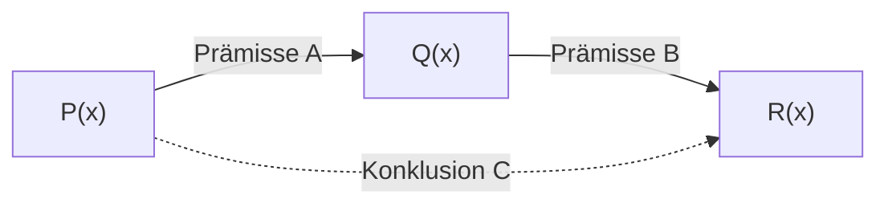

kontinuierliche Mathematik heißt keine Löcher
diskrete Mathematik ist mit Löchern, also eig simpler

### Logik
- Zentrales Ziel der Mathematik ist Eindeutigkeit > Definitionen
- Zentrale Frage der Logik ist Erfüllbarkeit und (Allgemein-)Gültigkeit einer **Aussage** (Behauptung, Feststellung, Zusicherung)
	- Man kann einer Aussage entweder zustimmen oder ablehnen
	- Aussage ist **erfüllbar**, falls es eine Situation gibt, in der sie wahr ist
	- Aussage ist (allgemein-) **gültig** 
- Zur Prüfung sind Grundbegriffe wichtig:
	- **Junktoren**: und, oder, nicht, falls-dann (wenn-dann), genau-dann-wenn (falls-und-nur-falls), entweder-oder
	- **Quantoren**: für alle, es existiert (es gibt, für einige), für kein (es gibt kein)
	- Beispiel: *Wahrheitstabelle für Junktoren*

| **A** | **B** | A oder B | A oder B | Nicht A | Falls A dann B | A genau dann, wenn B | Entweder A oder B |
| ----- | ----- | :------: | -------- | ------- | -------------- | -------------------- | ----------------- |
| f     | f     |    f     | f        | w       | w              | w                    | f                 |
| f     | w     |    f     | w        | w       | w              | f                    | w                 |
| w     | f     |    f     | w        | f       | f              | f                    | w                 |
| w     | w     |    w     | w        | f       | w              | w                    | f                 |
- *syn* kurz für *synonym* (gleichbedeutend)
	- "falls A, dann B" syn "(nicht A) oder B" syn "B oder nicht A"
	- "A gdw B" syn "(falls A, dann B) und (falls B, dann A)"
	- "entweder A oder B" syn "nicht (A gdw B)"
	- "weder A noch B" syn "nicht (A oder B)" syn "(nicht A) und (nicht B)"

![[Pasted image 20261015102415.png]]
nicht A | A und B | A oder B
![[Pasted image 20261015102448.png]]
Falls A, dann B | A gdw B | Entweder A oder B 

- [[Diskrete Strukturen.pdf#page=15|Entsprechend kann man Wahrheitstabellen und Venn-Diagramme auch f¨ur drei und mehr Aussagen(variablen) erstellen]]
- **Konditional**: *falls-dann (wenn-dann)* - Der Wahrheitswert von B ist nur relevant unter der Bedingung, dass A wahr ist 
- **Bikonditional**: *genau-dann-wenn (falls-und-nur-falls)*
- Kausalität oder zeitliche Abhängigkeiten spielen in der Aussagenlogik keine Rolle: ”Falls Schweine fliegen können, ist π irrational.“
### Hinreichend vs. notwendig, ”impliziert“ 
- Ist ”falls A, dann B“ (allgemein)**gültig**, dann sagt man auch 
	- ”A ist **hinreichend** für B” bzw. ”B ist **notwendig** für A“ 
	- häufig auch: ”A **impliziert** B“, ”B folgt (logisch) aus A“ 
- Ist ”A gdw B“ **allgemeingültig**, dann ist A **hinreichend** und **notwendig** für B. 
  (A gdw B syn falls A, dann B; und falls B, dann A.)

### [[Diskrete Strukturen.pdf#page=19|Beschränkte Quantoren]]
- Formal beschränkte Quantoren:
	- ”Alle x mit R(x) sind/haben/erfüllen auch P (x).“ 
	  ”Für alle x, für die R(x) wahr ist, ist auch P (x) wahr.“ 
	  ”Für jedes Objekt x gilt, falls R(x) wahr ist, dann ist auch P (x) wahr.“ 
	- ”Einige x mit R(x) sind/haben/erfüllen auch P (x).“ 
	  ”Es existiert ein x, für welches R(x) und zusätzlich auch P (x) wahr ist.“ 
	  ”Es gibt mind. ein Objekt x, das neben R(x) auch P (x) erfüllt.“
- Venn-Diagramme bzw. Euler-Diagramme
![[Pasted image 20261015105344.png]]

-  ”Einige $x$ mit $R(x)$ sind $P(x)$“ ist nur wahr, falls es ein konkretes Objekt $d$ gibt, für welches R(d) und P(d) wahr sind (d ist dann ein Beispiel oder Zeuge). 
	- Etwas formaler: ”Es existiert x, so dass R(x) und P(x)“ 
- ”Alle $x$ mit $R(x)$ sind $P(x)$“ ist nur falsch, falls es ein konkretes Objekt $d$ gibt, für das $R(d)$ und nicht $P(d)$ wahr ist (d ist dann ein Gegenbeispiel). 
	- Etwas formaler: ”F¨ur alle x, falls R(x), dann P(x)“

### [[Diskrete Strukturen.pdf#page=23|Beweise]]

> [!note] Behauptung
> „If all bandersnatches are borogoves, and all borogoves are slithy, then all bandersnatches are slithy.“ ist gültig.

Die zu beweisende Aussage hat für geeignete Prädikate $P$, $Q$, $R$ die Form:

$$
\frac{
\begin{array}{rll}
\text{If} & \text{A} & \text{for all } x\text{: if } P(x)\text{, then } Q(x)\text{,} \\
\text{and} & \text{B} & \text{for all } y\text{: if } Q(y)\text{, then } R(y)\text{,}
\end{array}
}{
\begin{array}{rll}
\text{then} & \text{C} & \text{for all } z\text{: if } P(z)\text{, then } R(z)\text{.}
\end{array}
}
$$

Wann immer 🅐 und 🅑 wahr sind, hat also jedes Objekt mit Eigenschaft $P$ auch die Eigenschaft $R$, d.h. 🅒 ist wahr unabhängig von der (subjektiven) Interpretation von $P, Q, R$ („bandersnatch“, „borogoves“, „slithy“).

![[Diskrete Strukturen.pdf#page=24&rect=17,14,342,206|Diskrete Strukturen, p.19]]

[[Diskrete Strukturen.pdf#page=31|richtig, falsch, richtig, gültig]]
### Übliche Beweisstrategien
* **[[Diskrete Strukturen.pdf#page=35|Direkter Beweis:]]** (z. B. für „Falls $A$, dann $B$“: Nimm $A$ an und zeige über logische Schlüsse, dass $B$ wahr ist).
* **[[Diskrete Strukturen.pdf#page=36|Kontraposition:]]**
	- „Falls $A$, dann $B$“ **gdw** „Falls nicht $B$, dann nicht $A$“.
	- „Alle $x$ mit $P(x)$ sind $Q(x)$“ **gdw** „Alle $x$ mit nicht $Q(x)$ sind nicht $P(x)$“.
* **Widerspruch:** Man zeigt $A$, indem man „falls nicht $A$, dann falsch“ zeigt.
* **Beweis für „$A$ genau dann, wenn $B$“:** Zeige „falls $A$, dann $B$“ und „falls $B$, dann $A$“ (oder nutze eine Kette von Äquivalenzen).
* **Induktion**